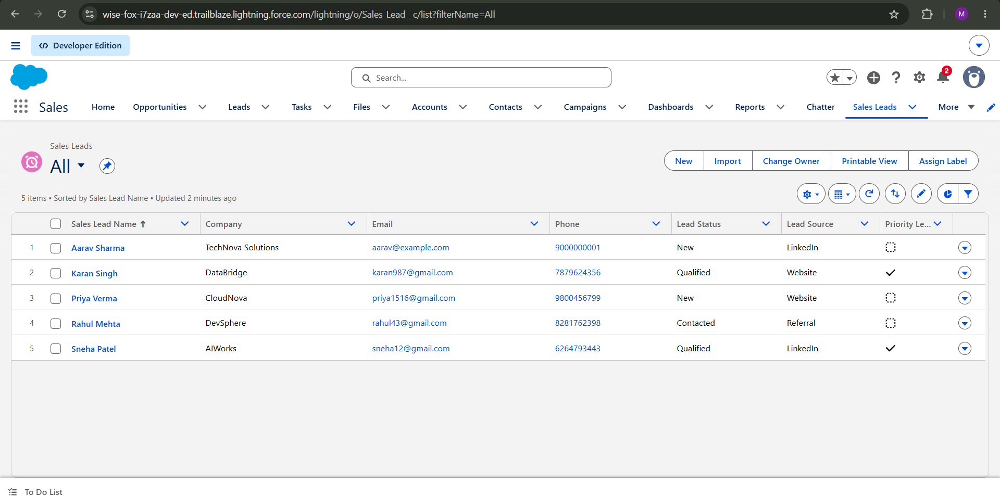
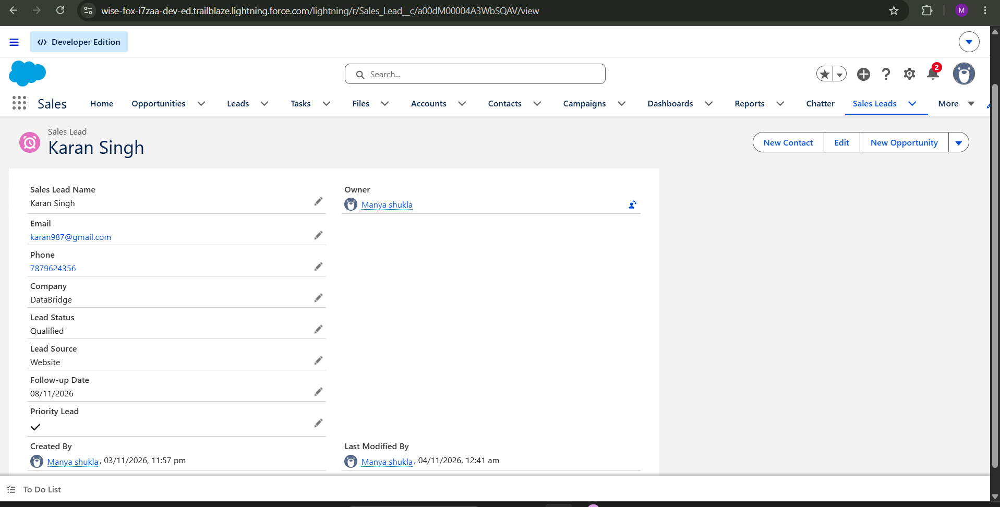
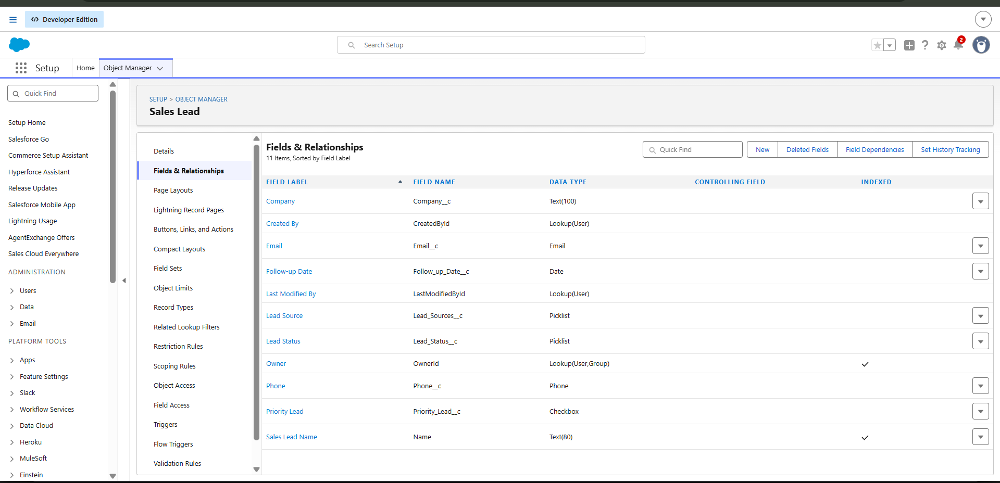
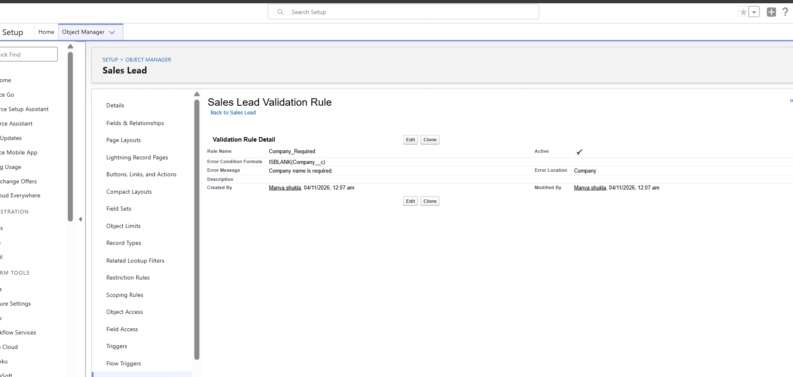
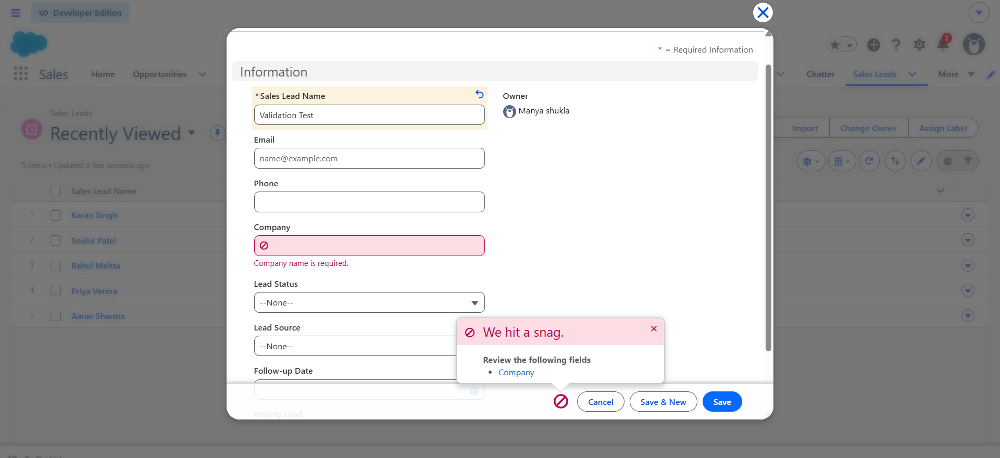

# SalesFlow CRM

**A Salesforce-based Sales Lead Management and Automation Platform.**

## Overview

SalesFlow CRM is a hands-on Salesforce project designed to manage sales leads, track their progress, enforce data validation, and automate lead prioritization.

The project demonstrates practical Salesforce Administration, CRM configuration, and business process automation.

## Features

- Custom Sales Lead object for managing lead records.
- Custom fields for company, email, phone, lead status, lead source, follow-up date, and priority.
- Validation rule to prevent saving leads without a company name.
- Record-triggered Flow to automatically mark Qualified leads as Priority Leads.
- Sales Lead report grouped by Lead Status.
- Dashboard featuring lead-status distribution and a lead-details table.

## Salesforce Concepts Used

- Custom Objects and Fields
- Picklists and Checkbox Fields
- Validation Rules
- Record-Triggered Flows
- Page Layouts and Field-Level Security
- Salesforce Reports and Dashboards

## Project Screenshots

### 1. Sales Leads List

### 2. Lead Record Details

### 3. Sales Lead Custom Fields

### 4. Company Validation Rule

### 5. Validation Test

## Automation Logic

When a Sales Lead record is updated and meets the Qualified status condition, the record-triggered Flow automatically sets the Priority Lead checkbox to True.

## Data Validation

The `Company_Required` validation rule prevents a Sales Lead record from being saved when the Company field is blank.

## Development Environment

- Salesforce Trailhead Playground
- Salesforce Lightning Experience

## Future Improvements

- Add KPI cards for lead metrics.
- Introduce additional dashboard filters.
- Implement advanced lead assignment and follow-up automation.
- Retrieve and version-control Salesforce metadata using Salesforce CLI.
- Explore Apex, SOQL, and Lightning Web Components.

## Project Status

**Current stage:** Salesforce CRM configuration, validation, automation, and initial documentation.

More screenshots, metadata, and technical documentation will be added as development progresses.

## Author

Built as a hands-on Salesforce CRM portfolio project.
