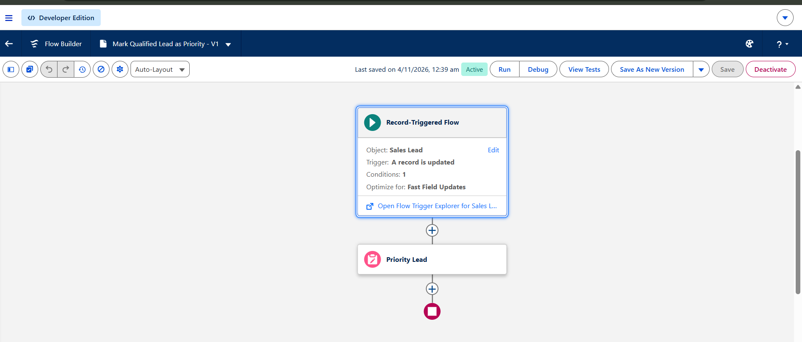
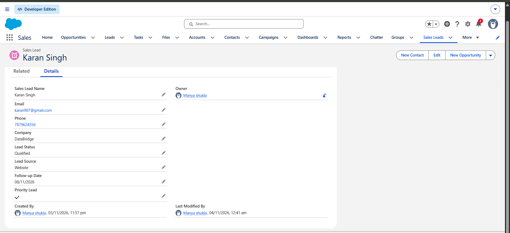
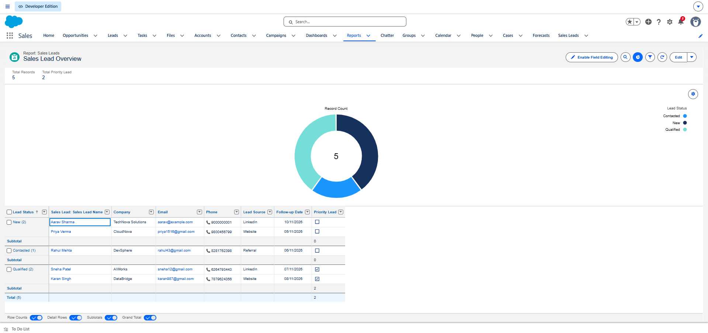
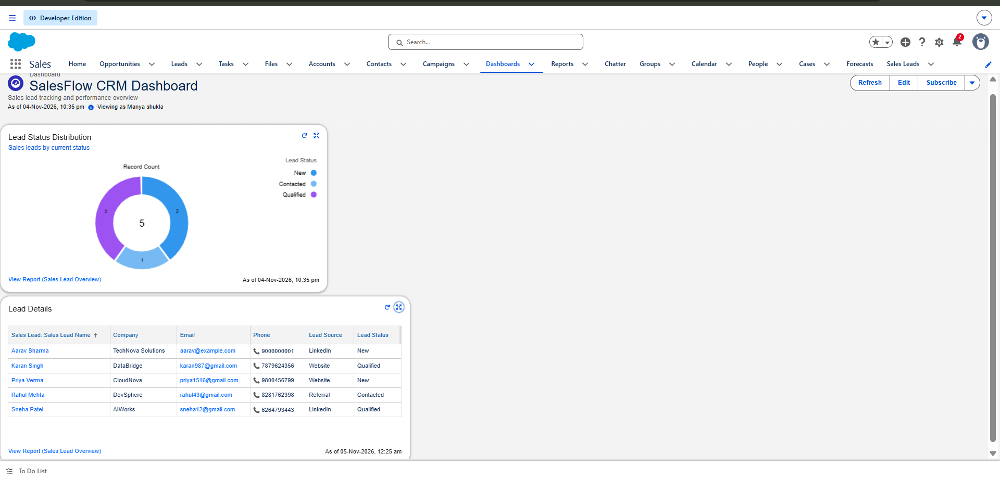

# SalesFlow CRM

A Salesforce-based Sales Lead Management and Automation Platform built in a Trailhead Playground. This project demonstrates custom data modeling, data validation, record-triggered automation, reporting, and dashboard creation using Salesforce declarative tools.

## Project Overview

SalesFlow CRM provides a simple way to track sales leads, maintain follow-up information, enforce basic data quality, and automatically mark qualified leads as priority records.

- **Platform:** Salesforce Lightning Experience
- **Environment:** Trailhead Playground (`SalesFlow-CRM-Dev`)
- **Project Type:** Salesforce Admin / Declarative Automation
- **Status:** Core MVP configured and manually tested

## Features

- Custom **Sales Lead** object with company, email, phone, lead status, lead source, follow-up date, and priority fields.
- Custom **Sales Leads** navigation tab.
- Sample lead records for demonstrating the workflow.
- Validation rule that prevents saving a lead without a company name.
- Record-triggered Flow that marks a lead as priority when its status changes to `Qualified`.
- Sales Lead report grouped by Lead Status.
- Dashboard with a lead-status donut chart and lead-details table.

## Salesforce Concepts Used

- Custom Objects and Custom Fields
- Custom Tabs
- Picklist and Checkbox fields
- Validation Rules
- Record-Triggered Flows
- Page Layouts and Field-Level Security
- Reports and Dashboards

## Screenshots

The screenshots below show the configuration and working results in Salesforce.

### 1. Sales Leads List


### 2. Lead Record Details


### 3. Sales Lead Fields


### 4. Company Validation Rule


### 5. Validation Test


### 6. Priority Lead Flow



### 7. Flow Test Result



### 8. Sales Lead Report



### 9. SalesFlow CRM Dashboard



## Automation Logic

**Flow:** `Mark Qualified Lead as Priority`

- **Object:** Sales Lead
- **Trigger:** When a record is updated
- **Entry Condition:** Lead Status equals `Qualified`
- **Run Condition:** Only when a record is updated to meet the condition requirements
- **Optimization:** Fast Field Updates
- **Result:** The Flow sets `Priority Lead = True` on the record that triggered the Flow.

This behavior was manually verified by changing a lead's status to `Qualified` and confirming that the Priority Lead checkbox became selected.

## Validation Rule

**Rule:** `Company_Required`

**Formula:**

```text
ISBLANK(Company__c)
```

The rule prevents a Sales Lead record from being saved when the Company field is blank. A manual test confirmed that Salesforce displayed the validation error.

## Reports and Dashboard

The `Sales Lead Overview` report groups records by Lead Status and includes lead details.

The `SalesFlow CRM Dashboard` displays:

- **Lead Status Distribution:** Donut chart based on the Sales Lead Overview report.
- **Lead Details:** Table showing the lead records.

## Repository Structure

```text
salesflow-crm/
├── README.md
├── .gitignore
├── docs/
│   ├── project-overview.md
│   ├── data-model.md
│   ├── automation-logic.md
│   └── testing.md
└── screenshots/
    ├── 01-sales-leads-list.png
    ├── 02-lead-record-details.png
    ├── 03-sales-lead-fields.png
    ├── 04-company-validation-rule.png
    ├── 05-validation-test.png
    ├── 06-priority-lead-flow.png
    ├── 07-flow-test-result.png
    ├── 08-sales-lead-report.png
    └── 09-salesflow-dashboard.png
```

Make sure the screenshot filenames in your repository match the paths used above. If your local filenames differ, update the corresponding image paths in this README.

## Setup and Reproduction

This project was configured in a Salesforce Trailhead Playground.

To explore the project in your own Salesforce environment:

1. Sign in to Salesforce using your own Playground or development org.
2. Open the **Sales Leads** tab.
3. Review the Sales Lead records and fields.
4. In Setup, review the active `Mark Qualified Lead as Priority` Flow and the `Company_Required` validation rule.
5. Open the `Sales Lead Overview` report and the `SalesFlow CRM Dashboard`.

This repository currently documents the configured project and its screenshots. Salesforce metadata retrieval and deployment instructions will be added after the org metadata has been retrieved and verified.

## Future Improvements

- Retrieve and commit the actual Salesforce metadata using Salesforce CLI.
- Add Apex classes and unit tests for developer-side functionality.
- Add SOQL examples for querying lead records.
- Explore Lightning Web Components (LWC) for a custom lead interface.
- Add role-based access scenarios and more comprehensive test cases.

## Author

**Manya Shukla**

